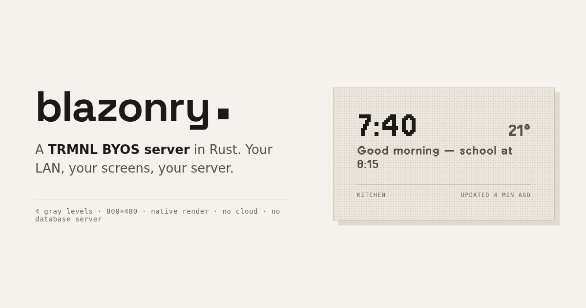
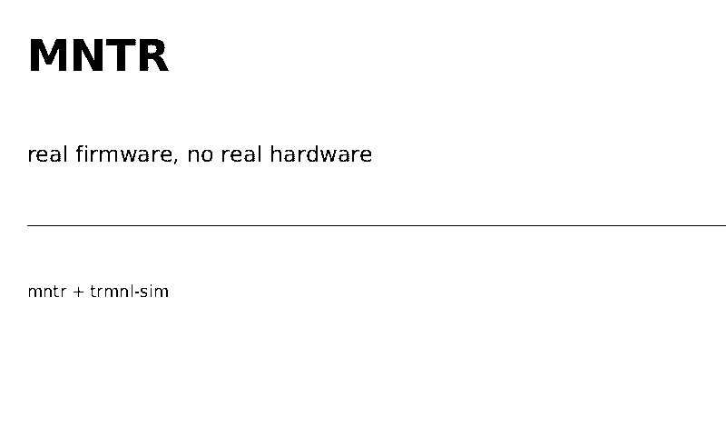
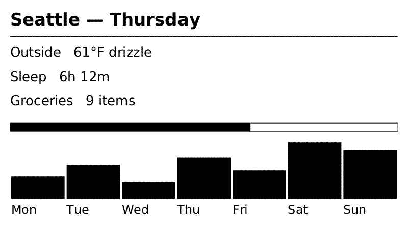
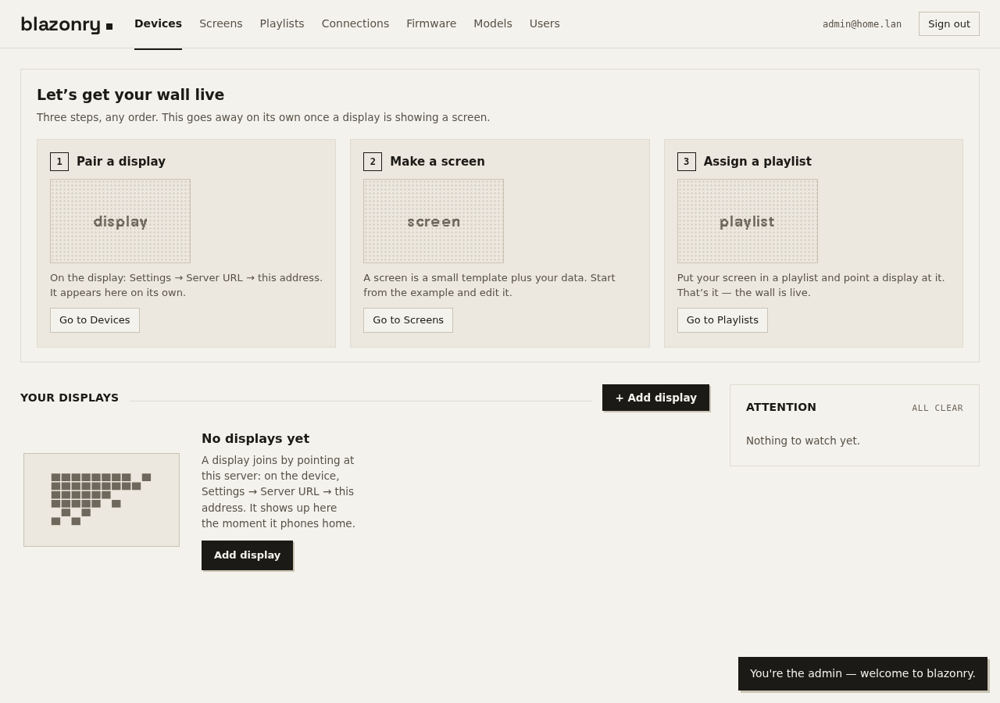
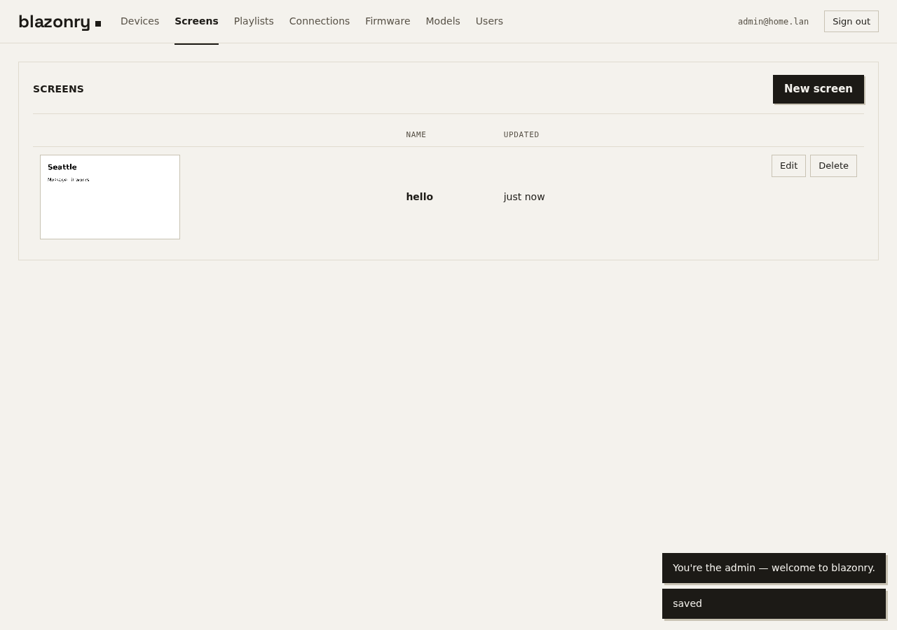
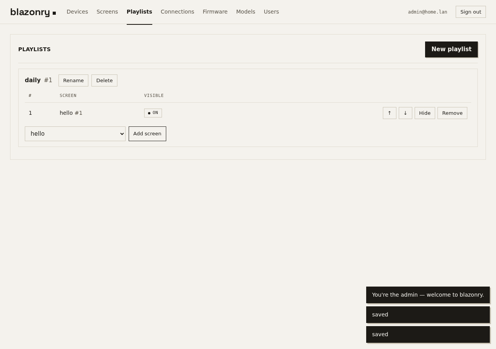
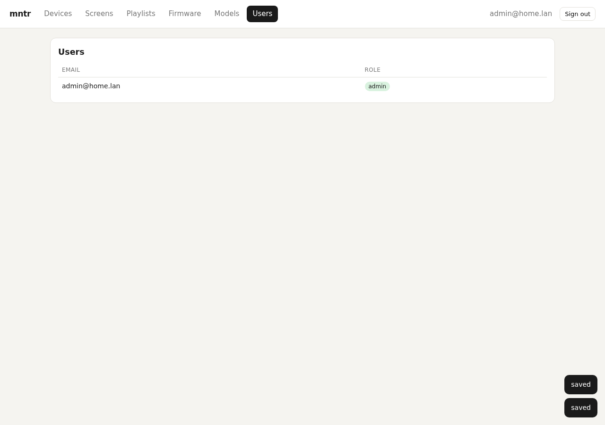

# blazonry

<p align="center">
  
</p>

**A TRMNL BYOS server in Rust. One 13 MB binary, no Chrome.**

Point your TRMNL (or any TRMNL-compatible ESP32 e-ink
display) at `http://your-server:2301` and you own the whole stack: screens,
playlists, device pairing, firmware OTA, users, previews — served from a
single static binary with an embedded web UI.

## Why blazonry

- **One binary.** `blazonry serve` — no Docker, no Postgres, no Redis, no
  asset pipeline. The whole state is one SQLite file, so backups are `cp`.
- **Native rendering.** Screens are rasterized in-process (tiny-skia +
  fontdue, ~5 ms per 800×480 frame, release build). No browser anywhere in the stack.
- **Your LAN works.** The device talks directly to your server. No cloud
  round-trip, no vendor in the middle.

Measured against the official Terminus Docker stack (three containers:
terminus, Postgres, Valkey):

| Stack | `docker pull` | On disk |
|---|---|---|
| Terminus (3 containers) | ~746 MB | ~1.84 GB |
| blazonry (1 container) | 6.3 MB | 15.7 MB |

~118× smaller to pull, and where Terminus's compose file budgets up to 4.5 GB
of memory across its services, blazonry idles in the tens of megabytes.

## Quick start

```bash
cargo install --path .        # or: download the release binary
blazonry serve                    # → http://0.0.0.0:2301
```

1. Open `http://your-server:2301`, register. **The first account becomes
   admin** (subsequent ones wait for verification — same model as Terminus).
2. On your display: Settings → Server URL → `http://your-server:2301`.
   The device pairs automatically and shows up on the Devices tab.
3. Create a screen (Liquid template + JSON vars), a playlist, assign it.
   Done — the device polls and renders.

No Docker, no database server, no reverse proxy required. The whole state
is one SQLite file (`--db path`), so backups are `cp`.

### Docker

```bash
docker run -d --name blazonry -p 2301:2301 -v blazonry-data:/data \
  ghcr.io/bloud-os/blazonry:latest
```

The image is a `FROM scratch` container around the static musl binary —
6.3 MB compressed, no shell, no OS. `linux/amd64` and `linux/arm64` (Pi-friendly).
The SQLite DB lives in the `/data` volume. To build locally:
`docker buildx build -t blazonry .` (multi-arch: `--platform linux/amd64,linux/arm64`).

## What you get

- **Device plane** — full TRMNL wire contract: `/api/display`, `/api/setup`,
  `/api/log`, `/api/latest_firmware`, image serving. Verified against the
  real firmware in QEMU, not just the docs (see [Testing](#testing)).
- **Admin web UI** — Svelte 5, SSR-prerendered and inlined into the binary.
  Devices, screens (with live previews), playlists, firmware, models, users.
- **Admin API** — bearer-auth CRUD mirroring Terminus `/api/*`: bulk device
  import, playlist item visibility, firmware wipe, log wipe.
- **Native renderer** — ~15 screen primitives (text, keyed_value, flex,
  progress, bars, divider) cover the TRMNL screen families; Liquid is the
  authoring surface, a JSON screen tree is the compile target.
- **Live sources** — providers pull data (CalDAV, Open-Meteo, Home Assistant);
  extensions turn it into screens (agenda, weather, dashboard tab).
- **OTA gating** — `update_firmware` only when the device's reported version
  differs from the newest firmware row (no OTA loops).
- **Battery-friendly** — stable filenames so devices skip unchanged
  downloads; `refresh_rate` in seconds as the firmware actually expects.

## Home Assistant

The Home Assistant provider renders one dashboard tab on the panel. It reads
the dashboard layout over the Home Assistant WebSocket API (`get_panels`,
`lovelace/config`) and entity values over REST (`GET /api/states`,
`POST /api/template`). Home Assistant does not expose Lovelace config over
REST, so the WebSocket connection is required, not optional.

Setup needs four values: the endpoint URL, a long-lived access token, the
dashboard, and the tab. In the admin dialog, **Find tabs** reads the real
dashboard and tab list from your instance, so you pick a tab instead of
guessing a path. A tab name that no longer exists fails at create time and
lists the tabs that do.

This is not a screenshot of Lovelace. A panel is 800x480, has four grey levels,
no colour, and no scroll, so the layout is the panel's own:

- **Fill carries state.** An active tile (light on, door open, unlocked,
  vacuum cleaning) is inverted black-on-white. Colour is unavailable, and
  "which of these is on" is the question a wall display answers.
- **States are words.** A door sensor says `Open`, not `on`. `unavailable` says
  `Unavailable`, never `Off`. A value too long for its cell wraps to a second
  line instead of being cut.
- **Uniform grid.** Lovelace `grid_options` sizes a scrollable web page whose
  width the operator chose. Here every tile is one cell of a `columns` grid.
- **Nothing disappears quietly.** Cards a panel cannot draw (graphs, maps,
  pictures, action buttons) are counted in the footer. A tab that maps to no
  tiles at all is a provider error, not a blank screen.

Extension settings: `columns` (2 to 4, default 4), `show_headings` (default
true), `max_tiles` (default: as many as fit). A panel holds roughly 12 to 16
cards. The provider refreshes every 15 minutes by default.

The token is a long-lived access token. Like every provider credential here it
is stored as plain JSON in the database and returned by `GET /admin/providers`,
so the admin session protects it. Mint it for a LAN device, and rotate it with
your other Home Assistant tokens.

`tests/ha_dashboard.rs` pins the mapping to a captured live config under
`tests/fixtures/`, with the household edited out. Upstream schema changes fail
a test instead of blanking the wall.

## Layout

```
src/screen.rs    screen vocabulary (~15 primitives)
src/template.rs  Liquid → JSON screen tree
src/markup.rs    HTML+Liquid recipe markup → screen IR (TRMNL class vocabulary)
src/ext_dev.rs   `blazonry ext new|check|render` — offline extension dev loop
src/liquid_compat/ Shopify-Liquid-compatible engine (filters, tags)
src/render.rs    measure/paint software renderer (tiny-skia + fontdue)
src/dither.rs    greyscale → 4-level Floyd–Steinberg dither
src/bmp.rs       2-bit bottom-up BMP writer (device wire format)
src/backend.rs   render backend trait (native; browser behind `browser` feature)
src/browser/     headless-Chromium backend + embedded framework assets
src/api.rs       device plane (TRMNL wire contract)
src/providers/   live sources (CalDAV, Open-Meteo, Home Assistant)
src/extensions/  ready-made screens built from provider snapshots
src/admin.rs     admin API (Terminus parity)
src/auth.rs      argon2 accounts, bearer sessions
web-app/         Svelte 5 source → node build.js → web/index.html
```

## Authoring extensions

Screens are HTML + Liquid using the TRMNL framework class vocabulary
(`layout--col`, `flex--row`, `gap--large`, `title--small`, …) — existing
TRMNL recipes import unchanged. The dev loop is offline: no server, no DB.

```
blazonry ext new weather        # scaffold ext/weather/ (template + vars)
blazonry ext check ext/weather  # validate; JSON diagnostics on stdout, exit code
blazonry ext render ext/weather # write the 800x480 2-bit BMP + PNG preview
```

`check` runs the full pipeline (vars → Liquid → front-end detect → IR →
pixel render) and names the failing stage (`vars|liquid|json|schema|markup|render`),
so agents can iterate headlessly. `tests/markup_corpus.rs` sweeps the
published-recipe corpus for parse coverage; `tests/markup_parity.rs`
(`--features browser` + a Chromium via `BLAZONRY_BROWSER_PATH`) asserts the
native renderer matches headless Chromium on the framework CSS
(median MAD < 0.15 over 4-level greys).

## Testing

Everything below is reproducible from a clean checkout with `cargo test`
plus two Python scripts; no physical hardware required.

### 1. Unit + end-to-end (`cargo test`)

- **Unit** — BMP header/bit-packing, dither output.
- **e2e** — spawns the real binary on an ephemeral port with a temp DB and
  drives the whole flow: admin gate 401 → register (first=admin,
  second=unverified) → verify → login (bad pw 401, unverified 403) →
  create screen/playlist → device pair/assign/poll → decodes the returned
  BMP and asserts a valid 800×480 2-bit image, playlist rotation, and the
  wrong-token `reset_firmware` path → PNG preview.
- **spec_conformance** — one test per contract line against the wire
  contract: TRMNL BYOS docs, the private Display API docs, and Terminus
  `config/routes.rb` + the actual `app/actions/api/{display,setup,log}`
  sources (verified Oct 2026; the assertions encode the contract, the
  upstream sources are not vendored).
- **ha_dashboard** — drives the Home Assistant mapping against a captured
  live dashboard config (`tests/fixtures/`, household edited out): tab
  selection, container flattening, per-card mapping, state humanization, and
  a full render at every column count. Schema drift upstream fails here rather
  than blanking a screen.

### 2. Real firmware in QEMU (`scripts/e2e_sim.py`)

The docs lie; the firmware doesn't. This harness builds the **actual TRMNL
firmware** from source (PlatformIO, `pio run -e trmnl`) and runs it inside
QEMU via [trmnl-sim](https://github.com/mooselace/trmnl-sim), then drives it
against a freshly spawned blazonry:

```bash
cargo build --release
python3 scripts/e2e_sim.py \
  --firmware .pio/build/trmnl/FW1.8.16-trmnl.bin --seconds 240
```

The simulated device boots, pairs over the QEMU gateway, polls, downloads
the BMP, and decodes it. This pass caught bugs no doc review would:

- firmware sends `ID: <mac>`, not `idempotency-key` (a real device 401'd at setup)
- `refresh_rate` must be a **number of seconds** — a string reads as 0 and
  the device wakes continuously (battery killer)
- unknown access-token must return `{status:500, reset_firmware:true}`, not 401
- `image_url` must be absolute (it goes straight into `HTTPClient::begin`)
- the OG panel demands exactly 48,062-byte 1bpp BMPs; a base64 image
  inlined in the JSON OOMs the ESP32 heap (max alloc ~63 KB) — never inline

The device's decoded screen, captured from the simulator:

<p align="center"></p>
<p align="center"><sub>Real firmware in QEMU: the device decoded the BMP blazonry served.</sub></p>

A native render of a full dashboard (header, key/value rows, progress bar,
7-bar week chart) at 800×480:

<p align="center"></p>
<p align="center"><sub>Native render, 800×480: Liquid → screen tree → tiny-skia → 4-level dither.</sub></p>

### 3. UI end-to-end (`scripts/ui_check.py`)

Spawns the server on an ephemeral port + temp DB, drives the admin UI in
headless Chromium: register → login → create screen with Liquid + vars →
walk every tab → assert **zero JS console errors** (the pre-login
`/admin/me` 401 is expected and filtered). Exits nonzero on any error.

<p align="center"></p>
<p align="center"><sub>Devices: every paired display, live state derived from polls — never fabricated.</sub></p>

<p align="center"></p>
<p align="center"><sub>Screens: Liquid + vars on the left, the real native render on the right.</sub></p>

<p align="center"></p>
<p align="center"><sub>Playlists: order screens, assign to devices.</sub></p>

<p align="center"></p>
<p align="center"><sub>Users: self-registration, admin verification, argon2 passwords.</sub></p>

## Admin auth

`BLAZONRY_AUTH` selects the admin plane's auth mode. The device plane is
unaffected: a display authenticates every poll with its own Access-Token.

| Mode | Sign-in | Notes |
|---|---|---|
| `local` (default) | email + password, argon2 | Self-registration is open. The first account becomes admin. |
| `ldap` | directory bind | Registration is off. Users are provisioned on first bind. |
| `oidc` | authorization-code + PKCE | Registration is off. Users are provisioned on first callback. |
| `none` | nobody | The admin plane is open. LAN-trust deployments only. |

`BLAZONRY_ADMIN_TOKEN` adds a static bearer that the admin API accepts in every
mode. It exists for a machine caller that provisions a server over the admin API
and has no browser: under `oidc` and `ldap` no route mints a session from a
password, so such a caller has nothing else to use. The value must be at least 32
characters, and startup refuses anything shorter. It is a full admin credential:
treat it like a password, and do not hand it to a person who can sign in.

### Who is an admin under `oidc`

Two variables grant admin on a verified ID token. Either one is enough.

| Variable | Form | Grants admin when |
|---|---|---|
| `BLAZONRY_OIDC_ADMIN_EMAILS` | comma-separated addresses | the token's verified email is on the list |
| `BLAZONRY_OIDC_ADMIN_CLAIM` | `name=value` | the token carries that claim with that value |

A claim is the one that scales. An identity provider can say "this person is an
admin" once, in its own directory, and every app that trusts the provider reads
the same answer. An email allowlist is edited per app and goes stale when an
address changes.

A scalar claim compares as text. A list claim matches when any member equals the
value, so `groups=admins` works against a provider that publishes group
membership. Only the first `=` splits, so a value may contain one.

```sh
# A provider that sends a role claim.
BLAZONRY_OIDC_ADMIN_CLAIM=bloud_role=admin

# A provider that sends group membership instead.
BLAZONRY_OIDC_ADMIN_CLAIM=groups=authentik\ Admins
```

With neither variable set, the first person to sign in becomes admin and
everyone after them waits for verification.

## Status

Wire-compatible with TRMNL firmware 1.6.10+ (OG and X panels). The admin
plane uses INTEGER ids where Terminus uses UUIDs. No plugin marketplace —
that's the point: your data sources are your own HTTP endpoints, and
screens are Liquid you control.

## License

blazonry is licensed under the **GNU AGPL v3** (see `LICENSE`).
